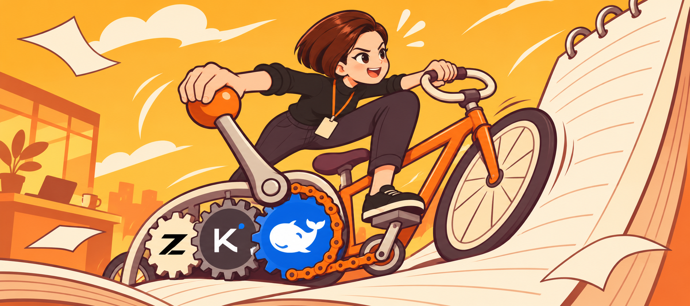
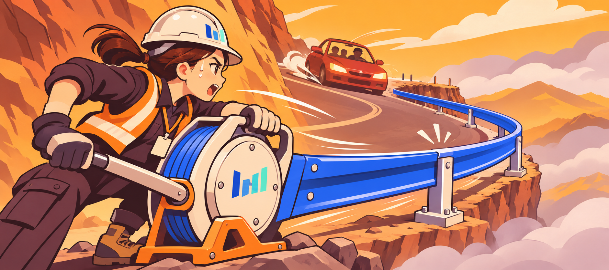

# 公众号封面参考

## Seedance 胶片

这张 Seedance 封面已获账号作者认可，可作为系列构图参考。一个小硬币在左下角弹出巨型胶片，胶片从缩小到放大，一路扫出画面。即使缩成列表里的小图，也能看见一个小物件带动了大动作。

## Hy4 flash 街边快印摊

这张试稿经账号作者认可，留作品牌叙事参考。WorkBuddy 猫是摊主，混元旋涡是投入机器的一枚硬币，一份大到把上班族掀起来的报表是交付结果。熟悉的街边场景和反常的动作一起表现「花小钱就能拿到实用成品」。暖橙负责场景，蓝和绿留给品牌图形。缩到列表尺寸时，注意给担任关键道具的混元图形留足面积。

## 豆包工作换挡

这张经账号作者认可，留作多品牌同框参考。豆姐穿着新版形象的黑高领，戴工牌，骑到办公笔记本掀成的陡坡前猛拉换挡杆。DeepSeek 的蓝鲸、Kimi 的 K 和智谱 Z.ai 的标记做成同一辆车的三个齿盘。只让链条挂在当前挡位，把「同一个工作台按任务换模型」变成一个看得懂的动作。三个图标集中在传动处，让角色、动作与参考品牌都能在小图里辨认。

## Seed 安全研究铺护栏

这张经账号作者选中，留作抽象议题叙事参考。车已经驶进山弯，研究员正用卷盘把蓝色护栏沿悬崖铺出去。让车和护栏在同一条弯道上争取时间，把「能力在加速，安全研究要跟上」变成一个有紧迫感的动作。车窗里有人，研究的意义就落到了具体乘客身上。蓝绿品牌图形放在卷盘上，与研究人员的动作一起出现。

构图参考了 [Bengio 的雾中山路比喻](https://yoshuabengio.org/en/blog/introducing-lawzero)，品牌图形参考了 [Seed 官方招募页](https://seed.bytedance.com/en/blog/seed-alignment-preparedness-team-looking-for-global-talents)。

## 创作时怎么用

下次从文章的观点出发，挑一个读者熟悉的东西，让它做出一个反常的动作。用大小对比、形状拉伸和简洁的色块把动作放大。按文章选择运动方向，给主体留出可辨认的轮廓和空间。

日常文章可从暖色出发。品牌文章先找品牌或产品的官方图标、吉祥物或熟悉的产品外形，再决定它在动作里扮演什么角色。保留最可识别的轮廓、配色和标记。产品名可以补充型号识别，画面的第一眼识别交给品牌图形。

用户给出的葬 AI 案例里，百度爪印是破壳而出的主角，腾讯企鹅在驾驶快艇。参考这种叙事关系。做 WorkBuddy 和混元时，可让 WorkBuddy 的猫脸图标担任行动者，让混元蓝色旋涡成为它使用的动力或工具。把画面缩到文章列表宽度，检查两个标识与动作是否还能读出。

出图前先用一句话讲出画面里的具体事件，明确谁在什么场景里做了什么，结果是什么。事件要讲出文章自己的观点。把品牌图形暂时遮住，如果剩下的场景只表达「更快」「更强」「更省」，再回到文章找更具体的矛盾或代价。

同篇候选共用一套画法和配色，分别试不同的隐喻与动作。蓝黄胶片图用于参考构图，配色随文章变化。
